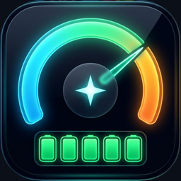
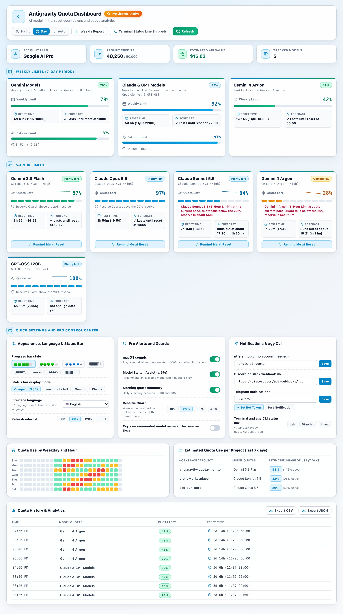
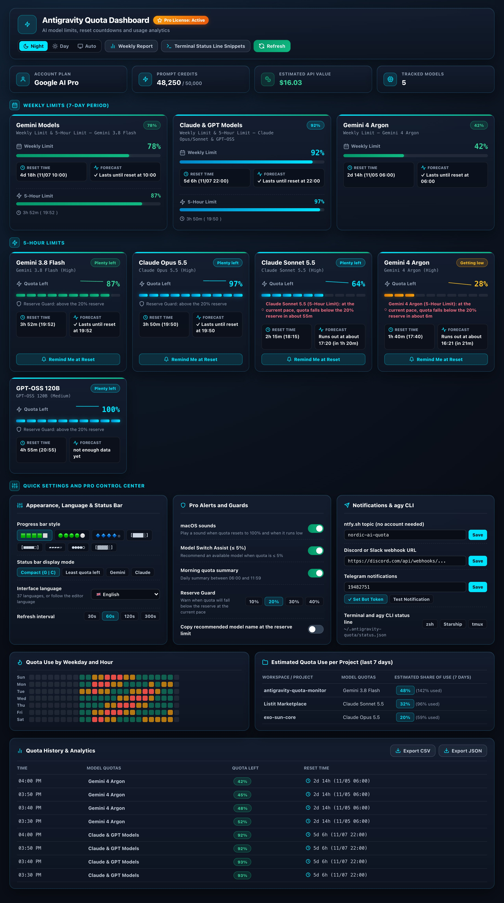
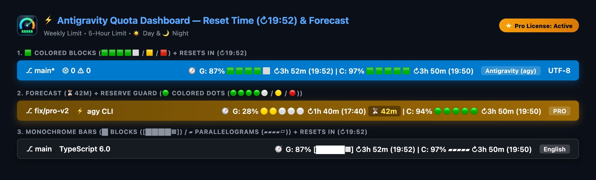
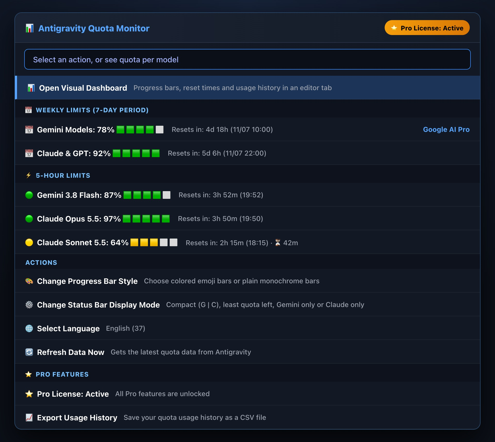
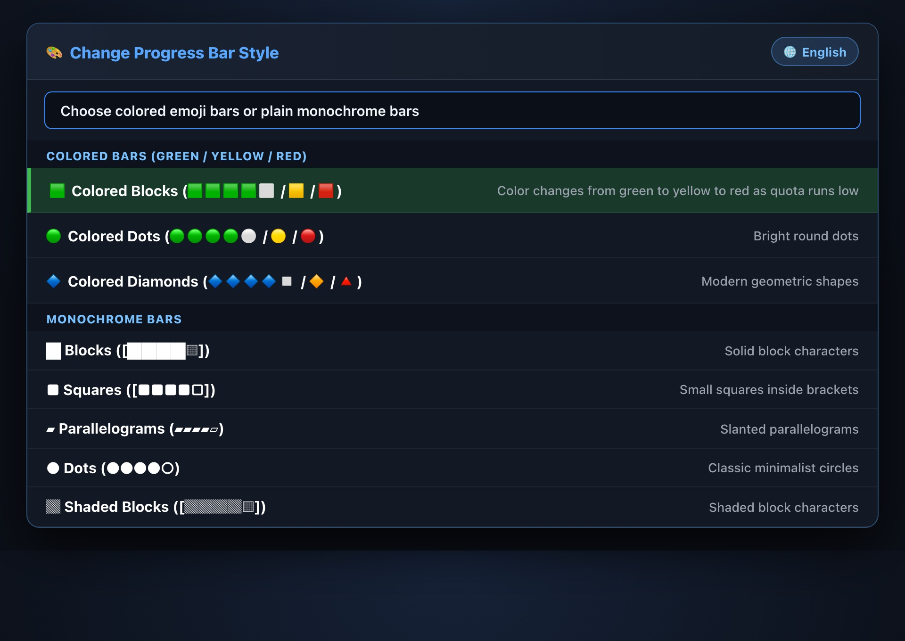

# ⚡ Antigravity Quota Monitor & Dashboard (Pro v2)

🌍 **37 Built-In UI Languages (Auto-Detected):** 🇬🇧 English · 🇪🇪 Eesti keel · 🇩🇪 Deutsch · 🇫🇮 Suomi · 🇪🇸 Español · 🇫🇷 Français · 🇮🇹 Italiano · 🇵🇱 Polski · 🇳🇱 Nederlands · 🇸🇪 Svenska · 🇵🇹 Português (Portugal) · 🇧🇷 Português (Brasil) · 🇧🇬 Български · 🇭🇷 Hrvatski · 🇨🇿 Čeština · 🇩🇰 Dansk · 🇬🇷 Ελληνικά · 🇭🇺 Magyar · 🇮🇪 Gaeilge · 🇱🇻 Latviešu · 🇱🇹 Lietuvių · 🇱🇺 Lëtzebuergesch · 🇲🇹 Malti · 🇷🇴 Română · 🇸🇰 Slovenčina · 🇸🇮 Slovenščina · 🇺🇦 Українська · 🇿🇦 Afrikaans · 🇯🇵 日本語 · 🇨🇳 简体中文 · 🇹🇼 繁體中文 · 🇰🇷 한국어 · 🇻🇳 Tiếng Việt · 🇮🇩 Bahasa Indonesia · 🇮🇳 हिन्दी · 🇰🇪 Kiswahili · 🇸🇦 العربية

  

  <strong>Real-Time AI Quota Monitor, Live Reset Clock (<code>↻19:52</code>), Run-Out Forecast &amp; Visual Dashboard (☀️ Day &amp; 🌙 Night Modes + On-Screen Control Center) for Google Antigravity IDE &amp; <code>agy</code> CLI.</strong> 
  <em>Tracks <strong>7-Day Weekly Limits</strong> &amp; <strong>5-Hour Limits</strong> across Gemini 3.8 Flash, Gemini 4 Argon, Claude Opus 5.5, Claude Sonnet 5.5, and GPT-OSS 120B in 37 languages.</em>

  
  
  
  

  
  &nbsp;&nbsp;
  

---

## 🔥 Live Preview — Pro v2 Visual Experience (☀️ Day Mode & 🌙 Night Mode)

### 🖥️ Pro Visual Dashboard: Crisp Daylight (☀️ Day Mode) & Cyber-Glass (🌙 Night Mode) + On-Screen Control Center
Switch effortlessly between **☀️ Day Mode**, **🌙 Night Mode**, or **Auto** right inside the Dashboard header — and control all 8 progress bar styles, display modes, 37 languages, Reserve Guard thresholds, audio chimes, push notifications (`ntfy.sh`, Telegram, Discord/Slack), and `agy` CLI snippets from a single screen:

#### ☀️ 1. Crisp Daylight View (Day Mode)

#### 🌙 2. Cyber-Glass Telemetry View (Night Mode)

### ⚡ Live Status Bar with Exact Reset Clock Time (`↻19:52`) & Pace Forecast (`⏳42m`)
See your remaining AI quota, visual progress bars, **live countdown + exact local reset clock time**, and **run-out pace warning** right on your Antigravity status bar:

### 📋 One-Click Quick Menu & 8 Progress Bar Styles

---

> [!IMPORTANT]
> ## 🚀 BUILT FOR GOOGLE ANTIGRAVITY (`agy` DAEMON), `agy` CLI & DUAL QUOTA WINDOWS
> Google Antigravity uses the local **`agy`** / `language_server` daemon with dual quota windows (**7-Day Weekly Limit** + **5-Hour Limit**).
> **Antigravity Quota Monitor v2.0 works everywhere `agy` runs:**
> - **🖥️ Works in Antigravity IDE, `agy` CLI & VS Code-Compatible Editors:** Supports **Google Antigravity IDE**, **Antigravity CLI (`agy` in terminal)**, **VS Code**, **Cursor**, **Windsurf**, and **VSCodium** (light and dark editor themes).
> - **☀️ Day Mode & 🌙 Night Mode + Full Control Center:** Choose crisp high-contrast Daylight, Cyber-Glass Night telemetry, or automatic editor-theme sync — with 10-cell LED meters, sparkline trend lines, and every setting toggleable on one screen.
> - **🤖 Supports All Antigravity AI Models:** Tracks **Gemini 3.8 Flash**, **Gemini 4 Argon**, **Claude Opus 5.5**, **Claude Sonnet 5.5**, **GPT-OSS 120B**, and automatically picks up new models reported by `agy`.
> - **⏱️ Dual-Window Limits + Live Reset Clock:** Monitors both your **📅 7-Day Weekly Limit** and **⚡ 5-Hour Limit** with live reset countdowns and exact local reset times (`↻3h 52m (19:52)`).
> - **🧠 Smart Pro v2 Tools:** Exponentially weighted run-out forecasts, Reserve Guard, 90-day JSONL history + `7×24` usage heatmap, per-project usage attribution, terminal `status.json` for `agy` CLI (`zsh`, `Starship`, `tmux`), reset alarms, weekly reports, and opt-in notifications (`ntfy.sh`, Telegram, Discord/Slack).

---

## 💻 Using with `agy` CLI, Terminal & Other Editors

| Environment / Tool | How It Works |
| :--- | :--- |
| **Google Antigravity IDE** | Live Status Bar (`G: 87% 🟩🟩🟩🟩⬜ ↻3h 52m (19:52)`), Dual-Window Hover Tooltip, Quick Menu, and Full Webview Dashboard (☀️ Day & 🌙 Night Modes). |
| **Antigravity CLI (`agy` CLI) & Terminal** | Atomically writes `~/.antigravity-quota/status.json` on every poll (`G:87% ↻3h 52m (19:52) \| C:97% ↻3h 50m (19:50)`). Includes ready-to-paste snippets for **`zsh` (`RPROMPT`)**, **`Starship`**, and **`tmux`**. |
| **Cursor / Windsurf / VS Code / VSCodium** | Detects the running local `agy` or `language_server` process and displays live quotas inside any VS Code-compatible editor (`agy --install-extension Nordicstocks.antigravity-quota-monitor`). |
| **All AI Models & Plans** | Tracks **Gemini 3.8 Flash**, **Gemini 4 Argon**, **Claude Opus 5.5**, **Claude Sonnet 5.5**, **GPT-OSS 120B**, and future `agy` model buckets. |

---

## ⚡ Free vs ⭐ Pro Features

<!-- FEATURES_TABLE_START -->
| Feature | 🆓 Free Version | ⭐ Pro Edition (€2.49/mo or €9.99 One-Time) |
| :--- | :---: | :---: |
| **Real-time Status Bar Widget & Dual-Window Countdowns** | ✅ Included | **✅ Included** |
| **Modern `agy` Daemon & CLI Compatibility** | ✅ Included | **✅ Included** |
| **Custom Progress Bar Styles** (8 Colored & Monochrome Scales) | ✅ Included | **✅ Included** |
| **Interactive Visual Dashboard** (☀️ Day & 🌙 Night Modes + On-Screen Control Center) | ✅ Included | **✅ Included** |
| **Multi-Language UI** (37 Languages: All EU + Global) | ✅ Included | **✅ Included** |
| **Basic Visual Quota Reset & Low-Quota Warnings** | ✅ Included | **✅ Included** |
| **24-Hour Local Quota History** | ✅ Included | **✅ Included** |
| **⏳ P1: Status Bar Live Reset Clock (`↻19:52`) & Run-Out Forecast** (5h & weekly windows) | ❌ | **✅ Included** |
| **🔄 P2: Model Switch Assist** (Recommends an available model & copies its name in 1 click) | ❌ | **✅ Included** |
| **🛡️ P3: Reserve Guard** ("Keep 20% for tomorrow" + pace breach alerts) | ❌ | **✅ Included** |
| **📈 P4: 90-Day JSONL History, Sparkline Trend Lines & Weekday×Hour Usage Heatmap** | ❌ | **✅ Included** |
| **📱 P5: Phone & Desktop Notifications** (`ntfy.sh`, Telegram Bot, Discord/Slack Webhooks) | ❌ | **✅ Included** |
| **🗂️ P6: Per-Project Workspace Usage Attribution** (Estimated quota use by project) | ❌ | **✅ Included** |
| **💻 P7: Terminal & `agy` CLI Status Line** (`~/.antigravity-quota/status.json` + zsh/Starship/tmux) | ❌ | **✅ Included** |
| **⏰ P8: One-Click Reset Alarms & Morning Quota Summary** | ❌ | **✅ Included** |
| **📊 P9: Weekly HTML & Markdown Usage Report** | ❌ | **✅ Included** |
| **🔔 macOS System Audio Chimes** (`Glass.aiff`, `Sosumi.aiff`, `Basso.aiff`, macOS only) | ❌ | **✅ Included** |
| **📥 CSV & JSON Usage History Export** (Up to 90 days) | ❌ | **✅ Included** |
<!-- FEATURES_TABLE_END -->

---

## 🚀 Get Started in Seconds

### 1. Purchase Pro License
Choose the plan that suits you best:
- **[💎 Buy Lifetime Pro — €9.99 one-time](https://buy.polar.sh/polar_cl_xdY0LqtPIfPHfnG9o8Wo5QIIpJRlvhxQOZ6vL4g5jIB)** (One-time payment, includes future updates)
- **[🔄 Monthly Pro — €2.49/month](https://buy.polar.sh/polar_cl_avl0NAvpPN4jQD0vZRRg11yZ92BQ2OHCKw29f4dxlPW)** (Billed monthly, cancel anytime)

Your license key is displayed on checkout and sent to your email.

### 2. Activate & Use in Antigravity IDE, `agy` CLI, Terminal & Other Editors
- **In Antigravity IDE / VS Code / Cursor / Windsurf:**
  1. Open the menu (`Cmd + Shift + P` -> `Antigravity Quota: Open Menu` or click the status bar item).
  2. Select **⭐ Enter Pro License Key**.
  3. Paste your Polar.sh license key to unlock all Pro features.
- **In `agy` CLI & Terminal (`zsh`, `Starship`, `tmux`):**
  1. Install via CLI: `agy --install-extension Nordicstocks.antigravity-quota-monitor`
  2. Run `Cmd + Shift + P` -> `Antigravity Quota: Terminal Status Line Snippets (Pro)` (or read live JSON from `~/.antigravity-quota/status.json`).

---

## 🔒 Privacy & Network Transparency

This extension is built with local-first privacy:
1. **Local Quota Polling (`127.0.0.1` only):** Quota status is read from your local Antigravity `agy` / `language_server` process on `127.0.0.1`. Prompts, code, conversations, and local CSRF tokens never leave your machine.
2. **Pro License Verification (`api.polar.sh`):** When you enter a Pro license key, the extension sends `{ key, organization_id }` (and your stored `activation_id` when applicable) to `https://api.polar.sh/v1/customer-portal/license-keys/validate` (and `/activate` when activation limits apply), revalidating every 24 hours with a 7-day offline grace period.
3. **Opt-In Notifications (Pro, off by default):** Only when you configure a notification channel (`ntfy.sh`, Telegram Bot, or Discord/Slack webhook), quota alert messages are sent to your chosen endpoint without local filesystem paths.

---

## 📄 License
[MIT License](https://opensource.org/licenses/MIT) © Nordicstocks
